# Auditoría UX/UI y propuesta de arquitectura — AI Builders GT

**Sitio en vivo:** [https://www.aibuildersgt.com](https://www.aibuildersgt.com)  
**Alcance:** solo observación. Este PR no cambia código de la app.  
**Fecha de medición:** 15 de octubre de 2026  
**Páginas:** `/`, `/eventos/xela-2026`, `/registro-hackathon`  
**Viewports:** escritorio 1440×900 y móvil 390×844  

---

## 1. Resumen

El sitio **sí es funcional** y ya cumple el trabajo principal que describe el producto: un visitante móvil entiende que AI Builders GT es una comunidad de Guatemala, que Xela 2026 ya ocurrió, y puede salir al grupo de WhatsApp con el CTA canónico **«Entrá al grupo»**. La identidad visual es fuerte (noche `#0F0A1E`, shout Barlow Condensed, fotos cívicas de Xela, una sola banda teal). El voseo guatemalteco en las puertas («Entrá», «abrilo») es coherente.

Lo que frena el siguiente salto —de landing de comunidad a **plataforma**— no es la falta de páginas, sino tres deudas estructurales:

1. **Rendimiento móvil.** El reel del hero carga ~17 MB de SVG fotográficos. Lighthouse 12.8.2 midió LCP de **59 s** (móvil, sitio en vivo) y **~14,5 MB** de peso total. Quien llega desde Instagram o WhatsApp en 4G no ve «comunidad»; ve espera.
2. **Arquitectura de información a medias.** La home mezcla tres jobs sin jerarquía clara: unirse al WhatsApp, anotarse a charlas en Luma, y archivar Xela 2026. El hero de la comunidad sigue anclado a la fecha del evento pasado. La prueba social del recap es una lista de nombres, sin fotos, ganadores ni demos.
3. **El teal de acción se usa como texto**, no solo como puerta. Sobre púrpura `#4C1D95` llega a **2,0:1** (etiquetas de aliados). Eso viola WCAG 2.2 AA y también la regla de marca de `DESIGN.md` («action no es fondo de sección» — y tampoco debería ser el color de labels pequeños).

**Marca vs. brief de esta auditoría.** El brief pide ámbar `#F59E0B` *solo* para CTAs sobre oscuro y Poppins. El sistema implementado (`DESIGN.md` + CSS) usa **teal `#0F766E` como única puerta** y Barlow Condensed para el shout. **No conviene pintar las bandas de blanco-sobre-ámbar:** el contraste de `#FFFFFF` sobre `#F59E0B` es **2,15:1** (falla AA). El ámbar sí sirve como acento grande (p. ej. la palabra GT) o como fondo de botón con texto `ink`. El teal actual con texto blanco sí pasa AA (**5,47:1**).

### Veredicto en una línea

Casa visual convincente, conversión WhatsApp clara, **no lista todavía como plataforma**: hay que aligerar el hero, separar comunidad / charlas / archivo, y dejar de usar el color de puerta como texto de UI.

---

## 2. Método

| Lente | Fuente |
|---|---|
| Heurísticas de Nielsen (10) | Recorrido desktop + móvil sobre el sitio en vivo |
| WCAG 2.2 Nivel AA | Contraste 1.4.3 (4,5:1 texto normal, 3:1 grande), 1.4.11, tamaño de destino 2.5.8 (24×24 px), foco 2.4.7 / 2.4.11, nombre accesible 2.4.4 / 4.1.2 |
| Core Web Vitals | Umbrales [web.dev/articles/vitals](https://web.dev/articles/vitals) (LCP ≤ 2,5 s, INP ≤ 200 ms, CLS ≤ 0,1). Lab: Lighthouse 12.8.2 (INP no se mide; se usa TBT) |
| Mobile-first / conversión | Tráfico esperado Instagram + WhatsApp (`PRODUCT.md`); puertas WhatsApp y Luma |
| Código | Next.js 16 App Router, tokens en `src/app/globals.css`, contenido en `src/content/*`, Supabase ya presente para equipos/jurados |

No hay una skill de «UI/UX review» en el repo. Se usó la estructura de crítica de diseño (jerarquía, spacing, copy, consistencia, contraste, fit-for-purpose) y la skill de web performance (medir, no adivinar).

**Muestras.** Capturas limpias con Chrome headless (Puppeteer) en `audit-screenshots/live/{desktop,mobile}/…`. El embed de Luma a menudo llega vacío en headless (cookies de terceros); la captura de Chrome con perfil real está en `audit-screenshots/live/mobile/home/browser-charlas-luma.png`. Informes Lighthouse: `audit-screenshots/lighthouse/*.report.html` y `summary.json`.

El PageSpeed Insights / CrUX no devolvió datos de campo para este origen en esta corrida (sitio joven o tráfico bajo el umbral público). Las cifras de esta auditoría son **de laboratorio**.

---

## 3. Lo que ya funciona

- CTA canónico **«Entrá al grupo»** en hero, mitad y cierre del archivo; abre el invite de WhatsApp en pestaña nueva.
- Skip link «Saltar al contenido», `lang="es"`, JSON-LD de Organization/WebSite y Event, `robots` que excluye `/jurados`.
- Nav sticky real (no hamburger): Comunidad / Charlas / Xela 2026. En móvil el CTA del hero **sí entra en el fold** a 390×844.
- `prefers-reduced-motion` congela el reel Ken Burns.
- Charlas: fallback «Si el calendario no carga, abrilo en Luma».
- Registro del hackathon cerrado con honestidad (no hay formulario zombi).
- Voz local, no corporativa. Fotos del kiosco / Parque Centroamérica / Minerva anclan Xela.
- Tokens CSS (`--ink`, `--brand`, `--action`) y `DESIGN.md` ya son un sistema, no una paleta suelta.
- Supabase ya modela equipos y jurados con RLS y schema `private` — no se parte de cero para una base.

---

## 4. Hallazgos por severidad

Severidad: **crítica** = bloquea uso, conversión o cumplimiento AA de forma amplia; **alta** = daño claro de UX/marca/a11y; **media** = fricción o deuda; **baja** = pulido.

### Crítica

#### C1 — Peso del hero: LCP inviable en móvil

El reel (`CIVIC_REEL`) monta **cinco SVG** a pantalla completa, el primero de **5,3 MB** (`kiosco-svg-noche.svg`). Suma del directorio `/public/hero`: ~18 MB. No pasan por `next/image`. Lighthouse (simulación móvil, sitio en vivo):

| Página | Perf | LCP | Peso | CLS |
|---|---:|---:|---:|---:|
| Home live móvil | 68 | **59,1 s** | 14 520 KiB | 0 |
| Home live desktop | 75 | 10,4 s | 14 515 KiB | 0 |
| Evento live móvil | 66 | **59,7 s** | 13 853 KiB | 0 |
| Evento live desktop | 76 | 6,0 s | 13 847 KiB | 0 |
| Home local móvil | 66 | 65,5 s | 14 549 KiB | 0 |
| Home local desktop | 75 | 10,9 s | 14 540 KiB | 0 |
| Evento local desktop | 96 | 1,4 s | 13 871 KiB | 0 |
| Evento local móvil | — | error `NO_LCP` | 13 876 KiB | 0 |

LCP bueno es **≤ 2,5 s**. En móvil, el 99 % del LCP fue *render delay* (decodificar/pintar el reel), no TTFB (TTFB ~10–630 ms: el servidor está bien). CLS = 0 es un logro: la inestabilidad no es el problema, la **carga** sí.

El logo knockout del nav pesa **601 KB** para mostrarse a 1,8 rem. Fotos de speakers sin usar (`marvin-moises.png` 1,8 MB, `jennifer-zelada.jpg`, `rocio-rosas.jpg`) viven en `/public`.

**Fix:** un solo JPEG/WebP del kiosco (~150–250 KB) como LCP; el resto del reel lazy o un poster estático; `next/image`; comprimir el mark. Esto es el quick win de más impacto.

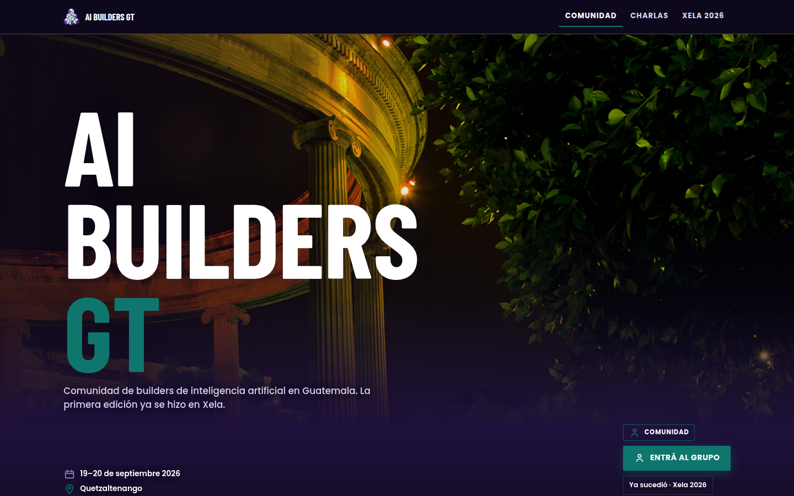

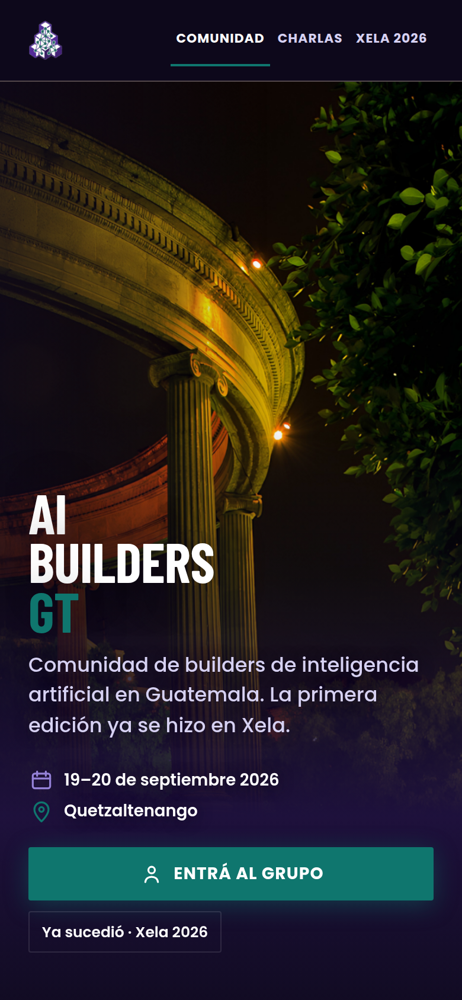

#### C2 — Tres productos en una home, un solo fold

El visitante ve al mismo tiempo:

1. Fecha y ciudad de **Xela 2026** (ya pasó).
2. CTA de **WhatsApp**.
3. Chip «Ya sucedió · Xela 2026».
4. En escritorio, un badge extra **«Comunidad»** encima del CTA (en móvil se oculta).
5. Más abajo, charlas Luma *y* el archivo.

Nielsen **#4 Consistencia** y **#6 Reconocer vs. recordar**: no hay un job primario en el fold. Quien llega el martes para la charla no encuentra Luma arriba; quien quiere la comunidad tropieza con una fecha pasada.

**Fix de IA (sin rediseñar aún):** el hero de `/` habla de la comunidad *ahora* (próxima charla o «el grupo sigue»); la fecha de Xela vive en Ediciones. Charlas como segunda puerta, no como iframe-sorpresa.

#### C3 — Contraste: teal como texto sobre púrpura / noche

Medición (sRGB relativo, no `color-mix`):

| Par | Ratio | AA texto normal (4,5:1) | AA grande (3:1) |
|---|---:|---|---|
| Blanco / ink `#0F0A1E` | 19,4 | Pasa | Pasa |
| Blanco / teal `#0F766E` (banda) | **5,47** | Pasa | Pasa |
| Teal / ink (GT, «YA SUCEDIÓ», roles) | **3,54** | **Falla** | Pasa si ≥ 18,5 px / 14 pt bold |
| Teal / brand-deep `#4C1D95` (`.ally-tier`) | **2,00** | **Falla** | **Falla** |
| Ámbar `#F59E0B` / ink | 9,03 | Pasa | Pasa |
| Blanco / ámbar | **2,15** | **Falla** | **Falla** |

Lighthouse confirmó fallos en `.edition-status` (3,12:1 sobre `#211241`), `.speaker-back-name` (3,36:1) y `.ally-tier` (2,0:1). El GT del hero a 46–192 px **pasa como texto grande**.


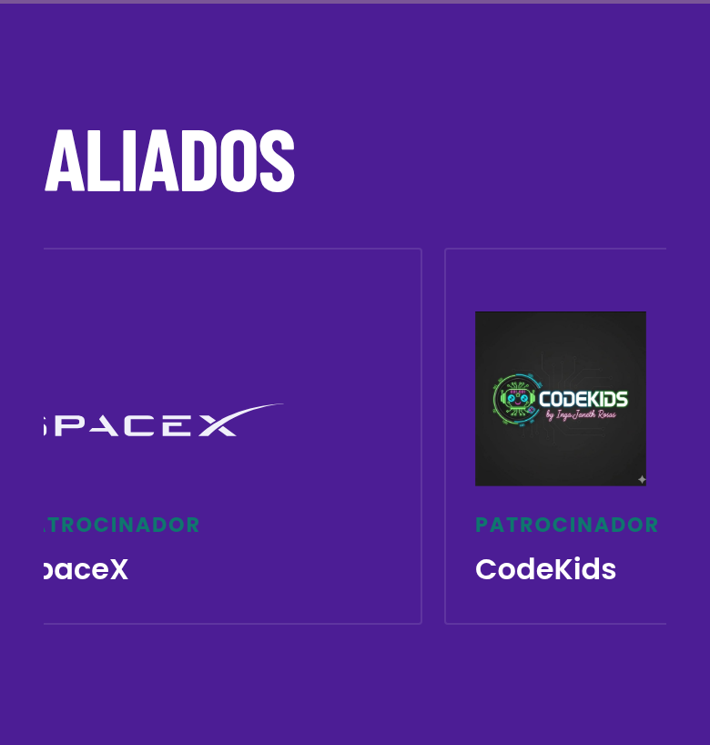

**Fix:** labels y roles en `--mist` o `--paper`; teal **solo** en la banda y el skip-link. Ámbar, si se introduce, como acento o botón con texto `ink`, nunca blanco sobre ámbar.

#### C4 — Nav móvil sin nombre accesible

En `≤799px` `.site-nav-name { display: none }` y el `<Image>` del lockup tiene `alt=""`. Lighthouse **link-name** en home y evento móviles: el logo no anuncia «AI Builders GT». WCAG 2.4.4 / 2.5.3.

**Fix:** `alt="AI Builders GT"` **o** un texto visually-hidden; no devolver el wordmark al fold si no cabe, pero el nombre tiene que existir para lector de pantalla.

---

### Alta

#### A1 — Embed de Luma: tema claro, inglés, zona horaria, fragilidad

La sección es el único «qué hay esta semana», pero:

- iframe `loading="lazy"` de **min-height 32 rem** (~2 pantallas en móvil) y UI **blanca** sobre noche;
- copy en inglés («Oct 21 Wednesday», «12:00 AM») — las 12:00 AM huelen a UTC, no a Guatemala;
- título Spanglish «Café con Builders with AI»;
- cookies de terceros (Lighthouse Best Practices 78–79 en home);
- en Chrome headless el iframe queda **blanco/vacío**; en Chrome real sí lista el evento.

Hay fallback, bien. Igual, Nielsen **#1 visibilidad de estado** y **#2 mundo real**: una charla guatemalteca no debería verse como un widget anglosajón a medianoche.

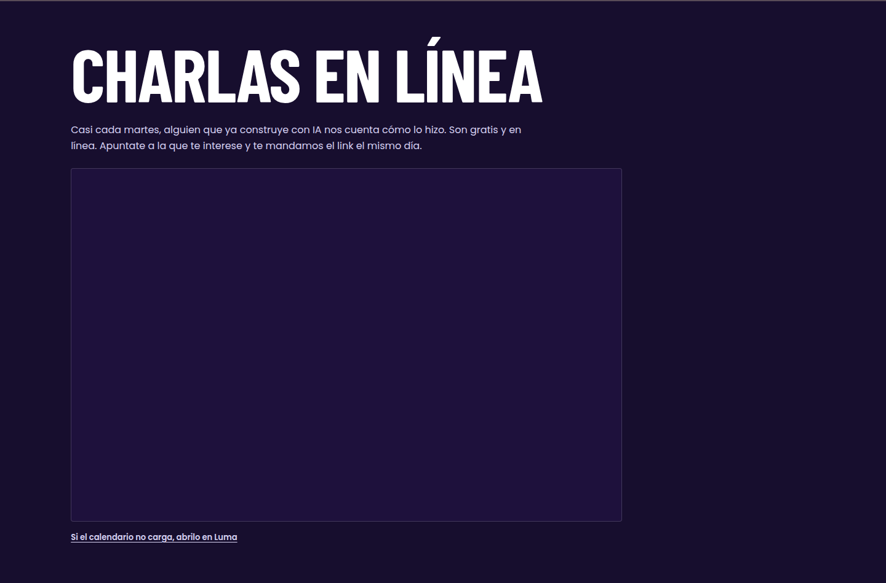

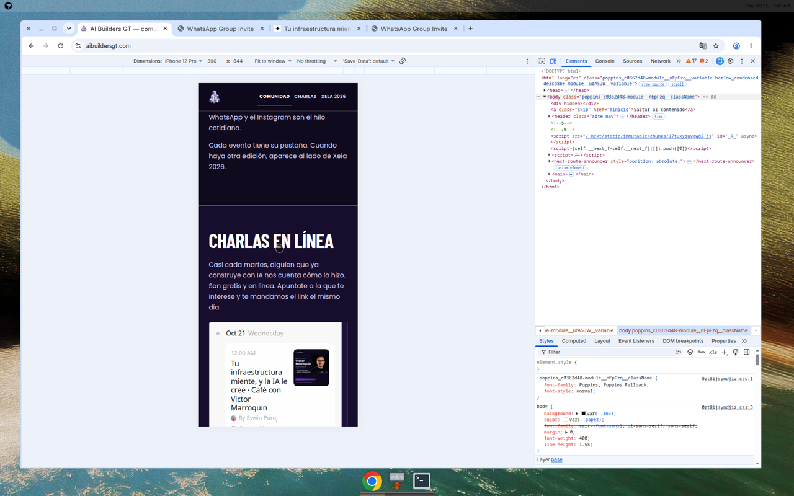

**Fix:** card propia (título, fecha hora **America/Guatemala**, CTA «Anotate en Luma») alimentada por API/RSS de Luma; el embed como degradación. `scroll-margin-top` ya está en `#charlas`; falta `aria-current` en la pestaña Charlas cuando el hash es `#charlas`.

#### A2 — Recap sin prueba: nombres, sin fotos, sin ganadores, sin demos

`event.recap.photos = []`, `winners` ausente, tracks todos `visible: false`. El lede de Ediciones promete «recap, speakers, agenda y sede»; el muro dice con honestidad que no hay fotos. Correcto éticamente, **débil para conversión y para «creerle»** (`PRODUCT.md`).

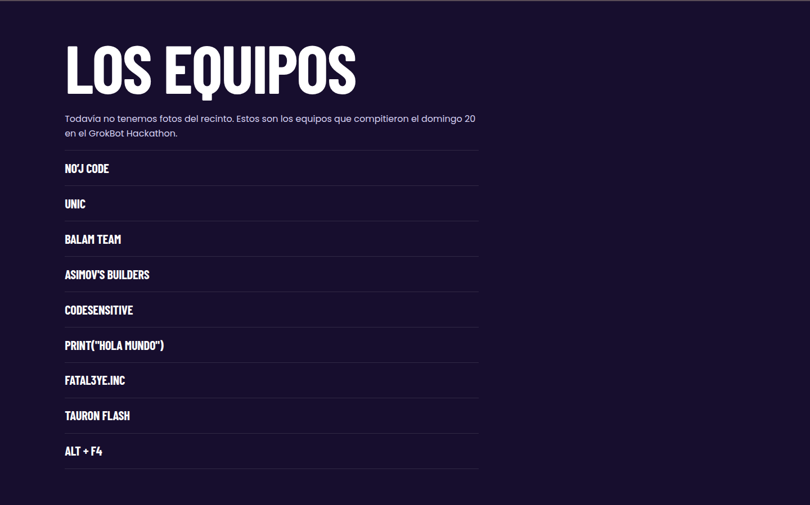

**Fix (contenido, no UI nueva):** 8–12 fotos reales, 1.º/2.º/3.º con proyecto, un párrafo del reto. Hasta entonces, no titular como archivo visual.

#### A3 — Agenda del sábado parece un choque de horarios

Un solo `rooms[]` (Aula Principal). Charlas presenciales y «En línea» se apilan en la misma columna: Yeffri 9:30–10:15 y Erick 9:30–10:30 se leen como solapadas. En `DESIGN.md` las dos aulas iban en paralelo; el dato ya no tiene dos aulas, el layout no se adaptó.

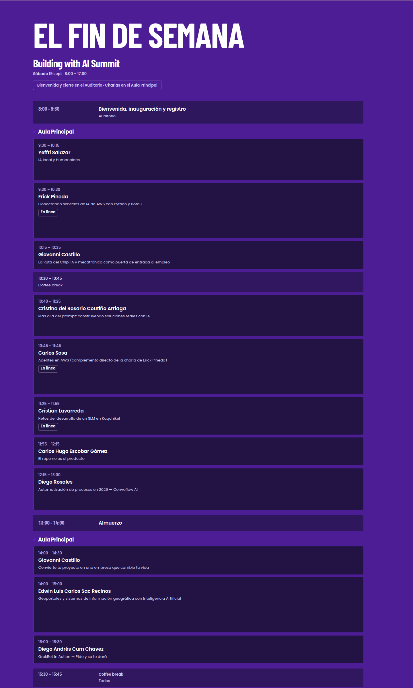

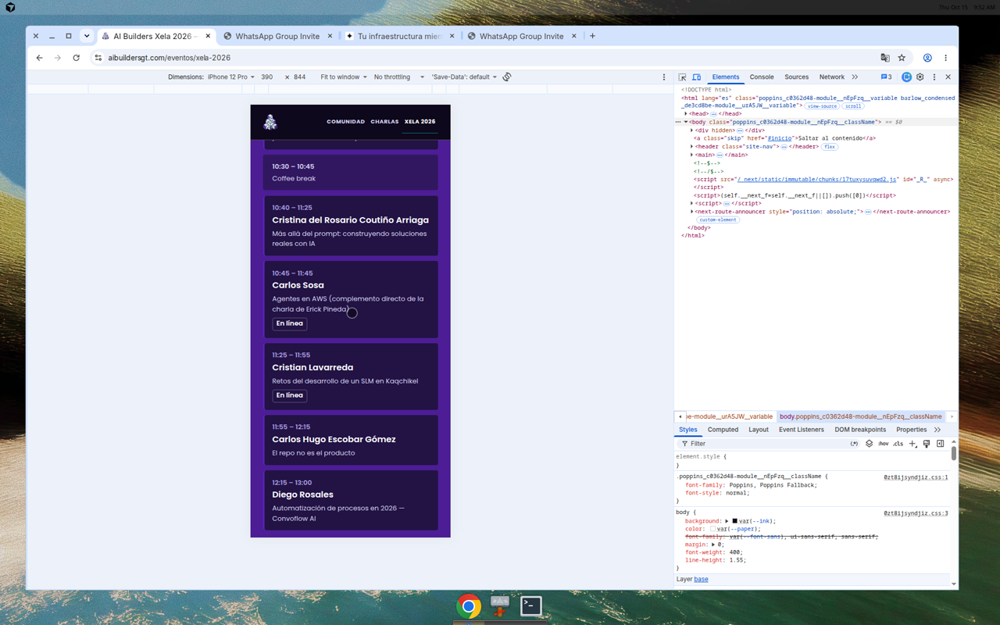

**Fix:** dos rieles «Presencial / En línea» o un disclaimer «en paralelo»; no una lista que parece error de programación.

#### A4 — Speakers: fotos tardías, flip poco descubrible, inglés, ARIA

- Primera pintura: placeholders púrpura (PNG de 1–2 MB sin prioridad).
- «Ver bio →» `opacity: 0` hasta hover/focus: en móvil no hay affordance.
- `aria-label="Ver perfil de X"` ≠ texto visible (nombre + tema) → Lighthouse `label-content-name-mismatch`.
- Título de sección **SPEAKERS** en inglés.
- Carlos Sosa sin `role`.
- Crops desiguales (selfie, Golden Gate, estudio).

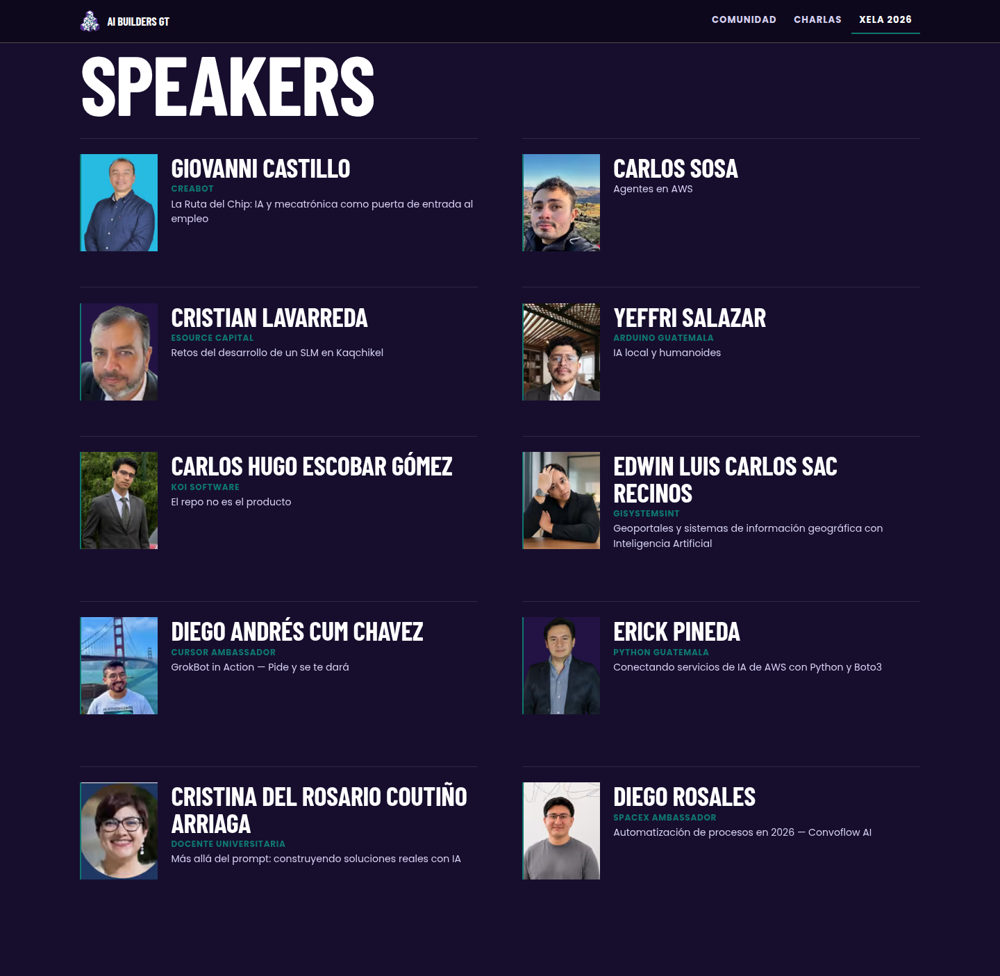

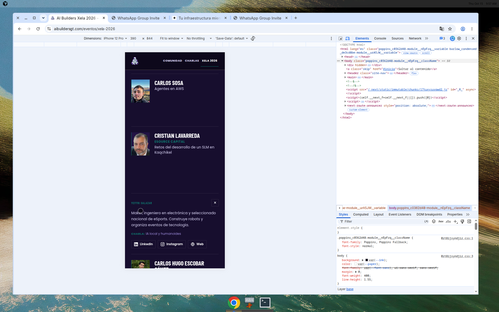

**Fix:** hint siempre visible; `aria-expanded`; título «Speakers» o «Quién habló»; comprimir retratos a ~40 KB WebP.

#### A5 — Sticky nav tapa encabezados (WCAG 2.4.11)

`--nav-h: 4.3125rem`. Solo `#charlas` tiene `scroll-margin-top`. Al scrollear el archivo, «Cierre del Día 1» y stats quedan bajo la barra. El foco de teclado puede quedar oscurecido.

#### A6 — Footer: correo personal, QR frágil, destinos menores de 24 px de alto

`eswinstuardporojcastro@gmail.com` es PII de organizador, no una puerta de comunidad. Links WhatsApp / Instagram / mail miden **20 px de alto** (WCAG 2.5.8). El QR existe (`public/community/whatsapp-qr.png`) y en Chrome real se ve; en headless a veces pinta un cuadrado blanco. `alt=""` está cubierto por `aria-label` en el ancla: eso sí cumple 1.1.1.

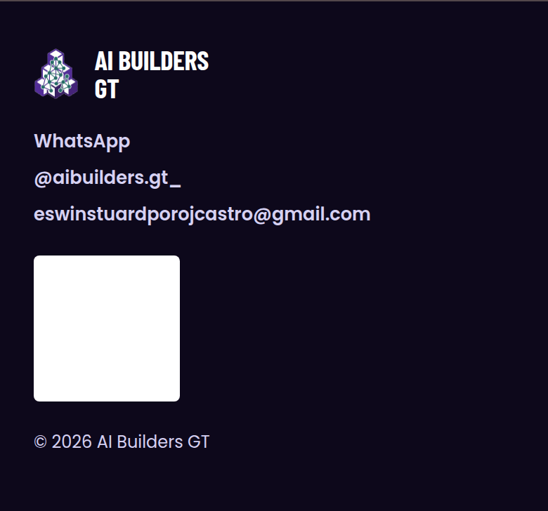

#### A7 — Integridad de aliados

- Tier «Presentado por Cursor Guatemala» en el plaque de **Grokbot Meetup**, con `href: https://cursor.com`.
- SpaceX como «Patrocinador» (el speaker es Ambassador): riesgo de lectura de *sponsorship* / marca.
- Carrusel auto (28 s de loop) recorta el primer logo en móvil (`PACE X`).
- Logos de aliados con `alt=""`; el nombre está en texto, OK, pero el rail duplicado (`ally-echo`) exige el `tabindex=-1` que ya hay.

#### A8 — Código muerto y mensajes viejos de conversión

`RegisterCta` + `getLumaUrl()` → `https://luma.com/ozqw0lw8` (evento puntual, no el calendario). `HackathonCtaSection` no está en el archivo. `event.ctas[].label` sigue en «Regístrate gratis». El sitemap incluye `/registro-hackathon`. `PRODUCT.md` aún habla de Luma como registro y de un evento futuro. Riesgo de que alguien «repare» la home enganchando el CTA viejo.

---

### Media

#### M1 — «La casa» explica el chrome, no la comunidad

Tres párrafos: definición, WhatsApp, «cada evento tiene su pestaña». Cero números de miembros, cero próxima cita, cero prueba. El H2 a 11 vw deja un mar vacío a la derecha en desktop.

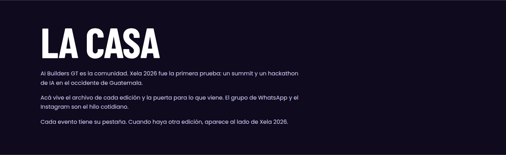

#### M2 — Ediciones: una placa en grid de dos

Una sola edición en `grid-template-columns: 1fr 1fr` deja un hueco. «YA SUCEDIÓ» en teal 3,5:1.

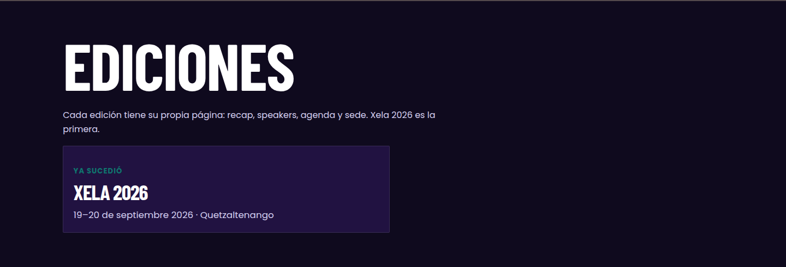

#### M3 — FAQ de archivo, no de comunidad

Preguntas en pasado (parqueo, pizza, fotos). La útil para el job actual es «¿Dónde me entero de lo que sigue?». No hay FAQ en la home. El `+` teal es el único giro permitido (`DESIGN.md`): bien.

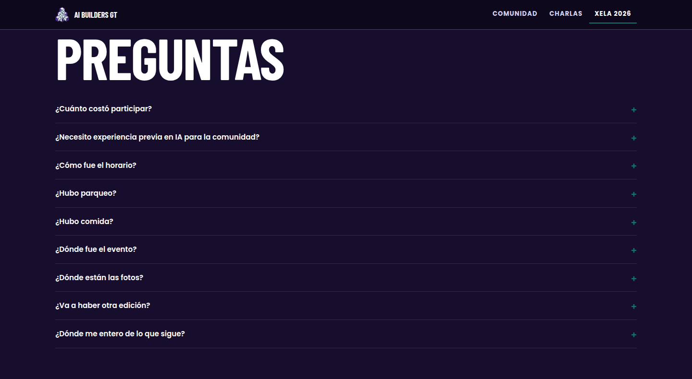

#### M4 — Stats del about: «Premios» no es un número

«10 / Premios / 2 días / Gratis» mezcla cifra, categoría y eslogan. «Premios en créditos de GrokBot» no cuantifica.

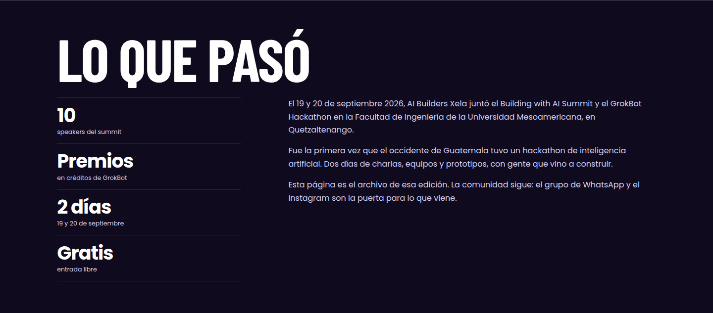

#### M5 — `html lang="es"` vs. `locale: es_GT`

Open Graph y JSON-LD dicen `es-GT` / `es_GT`; el documento `es`. Lectores y SEO pierden la variante.

#### M6 — Pestaña Charlas sin estado activo

`aria-current` solo en Comunidad (path `/`) y Xela 2026. En `/#charlas` Comunidad sigue «current». El `onClick` hace `replaceState` + `scrollIntoView`, correcto para reduced-motion, incompleto para estado.

#### M7 — Instagram sin `target="_blank"`

WhatsApp sí; Instagram en footer no. Inconsistencia de puertas externas.

#### M8 — Cierre: banda a todo el ancho, título partido

«YA PASÓ, PERO EL GRUPO / SIGUE» deja *SIGUE* solo. La banda teal full-bleed es la mejor puerta visual del sitio — y no es ámbar, a propósito.

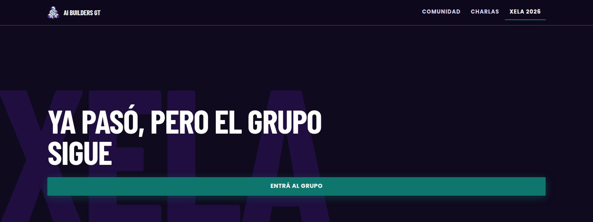

#### M9 — Registro cerrado: URL huérfana

`/registro-hackathon` es un archivo de equipos duplicado del recap. Útil para no romper links; debería `noindex` o canonical hacia el evento, y no figurar en `sitemap.ts`.

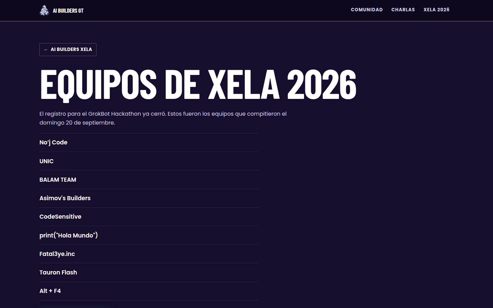

#### M10 — i18n y copy

- «Apuntate» (voseo correcto; la tilde «Apuntate»/«Anotate» es opcional en GT, menor).
- «SPEAKERS», «Tool partner», «Café con Builders with AI».
- No hay diccionario: strings incrustados en `community.ts` / `event.ts` (eso **ayuda** a extraer i18n después).

---

### Baja

- Watermark «XELA» del cierre: espectral, a veces compite con el título.
- IDs repetidos entre páginas (`#inicio`, `#sobre`) — OK por documento, mal si alguna vez hay layout con dos mains.
- Schema.org `EventCompleted` (el comentario en código admite que no está en la lista oficial; las fechas pasadas son la señal real).
- Canonical `https://aibuildersgt.com` vs. host `www`: unificar apex/www.
- Texturas `grain.png` / `wheatpaste.png` en public, no usadas en el sistema actual (`DESIGN.md` las rechaza).
- Jurados fuera del IA público: correcto `noindex`; no mezclar ese auth con futuros miembros.

---

## 5. Heurísticas de Nielsen (mapa)

| # | Heurística | Estado | Dónde |
|---|---|---|---|
| 1 | Visibilidad de estado | Débil | Luma vacío/claro; Charlas sin `aria-current`; LCP |
| 2 | Match con el mundo | Medio | Voseo bien; Luma en inglés; SPEAKERS; 12:00 AM |
| 3 | Control y libertad | Medio | Flip sin Escape documentado; rail auto; skip link sí |
| 4 | Consistencia | Débil | Teal como texto y como puerta; badge Comunidad solo desktop; PRODUCT.md vs. código |
| 5 | Prevención de errores | Débil | Agenda solapada; href Cursor en Grokbot; SpaceX «patrocinador» |
| 6 | Reconocer vs. recordar | Débil | Evento largo sin TOC; bio de speaker oculta; recap sin fotos |
| 7 | Flexibilidad | Bien | Destino 44 px en tabs móviles; CTA full-width móvil |
| 8 | Estética / minimalismo | Bien / deuda | Shout cívico excelente; huecos de grid; iframe blanco |
| 9 | Recuperación de errores | Bien | Fallback Luma; registro cerrado explícito |
| 10 | Ayuda | Medio | FAQ de archivo; nada de «cómo unirse» en la home más allá del CTA |

---

## 6. Conversión: WhatsApp y Luma

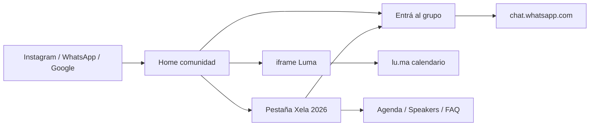

**WhatsApp (job #1, éxito del producto).**  
Puerta clara, label canónico, tres veces en el archivo, dos en la home (falta el cierre en `/` — solo hay mid-cta, no `FinalCtaSection`). El QR es un buen extra en desktop; en móvil el tap del ancla basta. **No está en la nav.** Quien scrollea Charlas o Ediciones no tiene la puerta a un pulgar de distancia.

**Luma (job #2, nuevo).**  
Serie «Café con Builders with AI», no el hackathon. El embed es la implementación más barata y la peor en marca/a11y/perf (third-party, tema claro). La pestaña Charlas es el descubrimiento; el CTA de Luma **compite** visualmente con WhatsApp en cuanto el iframe pinta blanco.

**Recomendación de conversión (sin rediseñar el look):**

1. Nav: Comunidad · Charlas · Xela 2026 · **Grupo** (chip, no segunda banda teal).
2. Home fold: un solo CTA teal WhatsApp; la próxima charla como **una card** debajo, no el calendario entero.
3. No reactivar `RegisterCta` / Luma `ozqw0lw8`.
4. Medir `data-cta="community-hero|mid|final"` (ya está en el DOM) con analytics.

---

## 7. Quick wins vs. cambios grandes

### Quick wins (contenido o CSS local, sin nueva IA)

1. Sustituir los 5 SVG del hero por **un** WebP/AVIF; `fetchPriority` solo en ese.
2. Comprimir `logo-mark-knockout.png` y retratos > 200 KB.
3. `.ally-tier`, `.edition-status`, `.speaker-role`, `.speaker-back-name`, `.hero-xela` móvil: color `paper` o `mist`, no `action`.
4. `alt` en el lockup; `scroll-margin-top` en todos los `section[id]`.
5. Hint «Ver bio» siempre visible; título «Speakers» en español.
6. FAQ: subir «próxima edición» y «grupo»; bajar parqueo/pizza o moverlas a un `<details>` «Del evento».
7. Footer: `hola@aibuildersgt.com` (o form); `min-height: 44px` en links; `rel` + `target` pares.
8. Quitar `/registro-hackathon` del sitemap; canonical al evento.
9. Corregir href del naming sponsor; aclarar SpaceX como Ambassador, no sponsor, si no hay contrato.
10. `lang="es-GT"`. Actualizar `PRODUCT.md` para que deje de pedir Luma de registro.

### Cambios grandes (plataforma / rediseño — **no en este PR**)

- Separar home de comunidad, índice de charlas y archivo de edición (sitemap de la §8).
- Card nativa de Luma + webhook/API.
- Muro de recap con fotos, ganadores, galería de proyectos.
- Design tokens + componentes `ui/` (hoy cada sección trae su CSS).
- Auth de miembros (distinto del gate de jurados).
- CMS para copy y blog.
- Decisión de marca **documentada**: o se confirma la puerta teal (`DESIGN.md`), o se define ámbar con texto `ink` y se actualiza el sistema. No las dos.

---

## 8. Arquitectura de información / sitemap propuesto

Hoy:

```
/                          Comunidad (hero + casa + charlas embed + 1 edición + CTA)
/#charlas                  Ancla
/eventos/xela-2026         Archivo monolítico (hero…FAQ)
/registro-hackathon        Archivo de equipos (cerrado)
/jurados                   Privado (noindex)
```

Propuesto (crece sin romper URLs actuales):

```
/                          Casa: qué es, prueba corta, próxima charla, puerta WhatsApp
/charlas                   Serie en línea (cards; Luma por debajo)
/eventos                   Índice de ediciones
/eventos/xela-2026         Archivo (se queda)
/proyectos                 Galería de demos (vacío hasta tener 3+)
/retos                     Challenges vigentes / archivo
/aliados                   Logos + relato (hoy solo rail en el evento)
/blog                      Notas / recaps (MDX)
/miembros                  Directorio público opt-in
/miembros/[handle]         Perfil
/cuenta                    Área logueada (más adelante)
/jurados                   Sigue aislado
```

Nav pública estable (máx. 5): **Comunidad · Charlas · Eventos · Proyectos · Grupo**. Ediciones de más viven bajo Eventos, no como cuarta pestaña infinita.

Prioridad de contenido en la home futura:

1. Quiénes somos (una frase + Xela como prueba).
2. Qué hacer hoy (grupo y/o próxima charla).
3. Prueba (foto + un ganador + un número verdadero).
4. Próxima edición cuando exista, no un hueco «Ediciones» con una placa.

---

## 9. Arquitectura técnica

### 9.1 Estado actual

```
src/app/(public)/          Home, eventos/[slug], registro-hackathon
src/app/jurados/           Gate + scoring (cookies, no Supabase Auth)
src/app/api/hackathon-board
src/components/sections/   Un CSS por muro
src/content/*.ts           Source of truth editorial
src/lib/luma.ts            IDs de calendario + URL vieja de evento
src/lib/supabase/{client,server,admin,env}.ts
supabase/migrations/       hackathon_teams + judges (private + RLS)
```

Stack: Next.js 16.3.2 App Router, React 19, Tailwind 4, `@supabase/ssr` 0.12.7. Home y evento son `force-static` / SSG. Jurados son dinámicos. Deploy Vercel.

### 9.2 Carpetas objetivo (incremental)

```
src/
  app/
    (public)/              marketing + archivo (sin auth)
    (member)/              /cuenta, /proyectos/nuevo
    jurados/               no mezclar
    api/luma/              webhook de eventos
  components/
    ui/                    Band, Chip, Wall, SkipLink, tokens
    community/             puertas WhatsApp / Instagram
    events/                Agenda, Recap, Speakers
  content/                 MDX + loaders tipados (o CMS)
  lib/
    supabase/              ya existe
    luma/                  client de calendario, no el CTA muerto
    i18n/                  diccionarios es-GT (en primero)
  styles/tokens.css        hoy :root en globals.css
```

No hace falta un monorepo. Sí hace falta **dejar de añadir secciones-isla** (`charlas.css`, `editions.css`, …) sin tokens compartidos.

### 9.3 Capa de datos

| Dominio | Ahora | Siguiente |
|---|---|---|
| Copy de comunidad / edición | TS (`community.ts`, `event.ts`) | Seguir en git hasta que un no-dev edite semanal; entonces CMS headless o tablas `pages` |
| Charlas | iframe Luma | Tabla `talks` **o** sync Luma (tag «Café con Builders with AI») → cards SSG + revalidate |
| Equipos hackathon | `hackathon_teams` + listing público | Congelar como archivo; no reabrir el RPC de registro |
| Jurados | `private.hackathon_*` + cookie | Dejarlo; **no** reusar ese gate para miembros |
| Perfiles | — | `profiles` (1-1 con `auth.users`), RLS `auth.uid() = id` |
| Proyectos / demos | — | `projects` (owner, edition_id, repo, demo_url, cover) |
| Retos | tracks `visible: false` en TS | `challenges` con edition_id, estado |
| Aliados | array en `event.ts` | `allies` reutilizable entre ediciones |
| Blog | — | MDX en repo (`content/blog/*.mdx`) primero |

Principios Supabase a respetar (ya rotos sería peor): RLS en todo lo expuesto; nada de `user_metadata` para autorización; vistas `security_invoker`; secret key solo en server; no `SECURITY DEFINER` para «arreglar» permisos de perfiles.

### 9.4 CMS / contenido

Fase web: **git es el CMS** (como ahora). Es lo correcto para un equipo de 1–2 organizers que ya despliegan.

Fase plataforma: MDX para blog/recap (preview en PRs) y, si hay editor no técnico, Sanity o las tablas de arriba. No instalar un CMS el día 1: duplica la fuente de verdad que ya está tipada.

### 9.5 Auth

- **Público:** nada.
- **Jurados:** cookie `abgt_jurado` + RPC — aislar.
- **Miembros:** Supabase Auth (magic link por correo; WhatsApp no es IdP). `@supabase/ssr` ya está. Cookies en Proxy/middleware cuando exista sesión. Perfiles opt-in al directorio.

No federar Instagram. No meter OAuth de Luma en el camino crítico.

### 9.6 i18n readiness

Hoy: un idioma, strings en módulos TS, OG `es_GT`.  
Listo para extraer: esos módulos **ya son diccionarios**.  
No listo: `lang="es"`, copy mezclada EN, Luma EN, sin `next-intl` / routing `/en`.  
Cuando haga falta inglés (aliados internacionales), extraer `messages/es-GT.json` **antes** de añadir locale, no al revés.

### 9.7 Design tokens / componentes

Ya existen en `:root`: `ink`, `paper`, `brand`, `brand-deep`, `action`, `mist`, `border-warm`, `wall-x`, `nav-h`. Falta:

- Token de **texto sobre action** (paper) vs **action como texto** (prohibido en tamaños de label).
- Token opcional `accent-amber` documentado: uso = acento grande o botón con `on-accent: ink`.
- Extraer `.band`, `.chip`, `.wall`, `.wall-title`, `.lede` a `components/ui`.
- Tipografía: **no tirar Barlow** sin decisión; el brief de Poppins-only choca con el shout cívico que *es* la marca.

---

## 10. Roadmap por fases (web → plataforma)

Sin calendarios: el orden es de dependencia técnica.

### Fase 0 — Sitio usable en 4G (sigue siendo «web»)

Hero ligero, contraste AA de labels, lockup con nombre, scroll-margin, sitemap limpio, PRODUCT.md alineado. Sigue una sola conversión: WhatsApp.

### Fase 1 — IA clara

Home = comunidad ahora + 1 card de próxima charla + 1 placa de edición. `/charlas` o ancla digna. Recap con fotos reales. Nav de 4 ítems. Medición de `data-cta`.

### Fase 2 — Contenido vivo

Sync Luma → cards. MDX para un recap/blog. Tabla `allies` + `editions` si la segunda edición aparece. Todavía sin auth de miembros.

### Fase 3 — Directorio y proyectos

Auth magic link, `profiles`, galería `projects` ligada a edición. WhatsApp sigue siendo el día a día; el sitio es el *portfolio* público.

### Fase 4 — Retos y plataforma

Challenges, inscripción a eventos (Luma o propia), posible newsletter. Jurados pueden reutilizarse en el próximo hackathon **sin** abrirlos al público.

Cada fase debe poder desplegarse con la anterior intacta. No construir `/miembros` encima de un hero de 18 MB.

---

## 11. Riesgos

| Riesgo | Por qué importa | Mitigación |
|---|---|---|
| Hero de 18 MB | Abandono móvil; mal CWV → SEO a medio plazo | Fase 0 obligatoria |
| WhatsApp como SPOF | Links de grupo caducan; no hay backup de miembros | Export periódico; lista de correo opt-in en Fase 3 |
| Embed Luma | Cookies, tema, idioma, headless vacío, 12:00 AM | Cards propias + enlace |
| Dual teal/ámbar | Un rediseño «por brand» puede **empeorar** AA (blanco/ámbar 2,15:1) | Decisión escrita en DESIGN.md |
| SpaceX / Cursor mal etiquetados | Marca y confianza | Copy de Ambassador vs sponsor; hrefs reales |
| PII en `hackathon_teams.contact` | Teléfonos/mails de participantes | No exponer; no copiar a perfiles públicos |
| Gate de jurados ≠ Auth | Mezclarlos abre el panel o deja perfiles inseguros | Schemas separados |
| Nav de pestañas por edición | A la 3.ª edición el header móvil revienta (ya se escondió el wordmark) | Índice `/eventos` |
| PRODUCT.md / ctas viejos | Un agente futuro «reactiva» Luma de registro | Actualizar docs en el primer PR de código |
| www vs apex | Señales SEO partidas | Un redirect 301 y un `SITE_URL` |
| CrUX vacío | No sabemos el p75 real | RUM (`web-vitals` → analytics) en Fase 1 |

---

## 12. Apéndice — Inventario de capturas y Lighthouse

Capturas de sección (Puppeteer, sitio en vivo):

- Home desktop/móvil: `audit-screenshots/live/{desktop,mobile}/home/` (`00-fold`, `inicio`, `sobre`, `charlas`, `ediciones`, `comunidad`, `site-foot`).
- Evento: `…/event/` (`inicio`, `sobre`, `recap`, `formato`, `speakers`, `comunidad`, `aliados`, `ubicacion`, `faq`, `cierre`).
- Registro: `…/registro/`.
- Tras scroll (iframe/mapas): `loaded-*.png`.
- Chrome real (Luma, flip, agenda): `browser-*.png`.
- Local (build `next start`): folds en `audit-screenshots/local/` — el HTML coincide con live; el LCP también.

Lighthouse HTML: `audit-screenshots/lighthouse/live-home-mobile.report.html` (y pares desktop/evento/local). Resumen numérico: `audit-screenshots/lighthouse/summary.json`.

---

*Auditoría de observación. Cualquier rediseño o parche de código debe ir en otro PR.*
